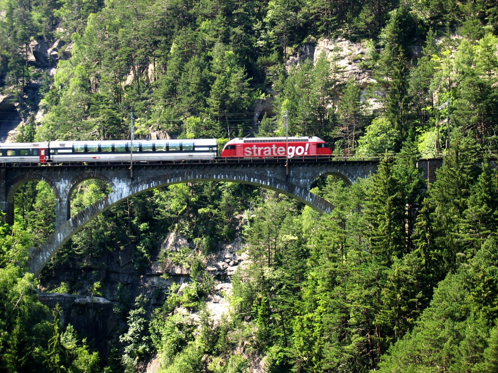

# Der große Gleis-Gipfel 2026

Willkommen beim jährlichen Treffen für moderne Schienenmobilität, Streckenplanung und nachhaltigen Zugverkehr. Gemeinsam stellen wir die Weichen für die Zukunft auf der Schiene.

---

## 1. Worum geht es beim Gipfel?
Beim diesjährigen Gleis-Gipfel kommen Experten, Lokführer und Planer zusammen, um über die wichtigsten Projekte des kommenden Jahres zu sprechen. Im Fokus stehen pünktlichere Verbindungen und der Ausbau regionaler Nebenstrecken.

* **Mehr Pünktlichkeit:** Neue digitale Stellwerke sollen Verspätungen deutlich reduzieren.
* **Grüne Züge:** Umstellung der letzten Dieselstrecken auf moderne Batterie- und Wasserstoffzüge.
* **Bessere Takte:** Schnelleres Umsteigen durch abgestimmte Fahrpläne an großen Knotenpunkten.

---

## 2. Programm-Highlights

| Uhrzeit | Programmpunkt | Ort |
| :--- | :--- | :--- |
| **09:30 Uhr** | Begrüßung & Eröffnungsrede | Gleis 1 – Haupthalle |
| **11:00 Uhr** | Workshop: Digitale Weichensteuerung | Konferenzraum Nord |
| **14:00 Uhr** | Besichtigung der neuen Regionalzüge | Außengelände Süd |

---

## 3. Anmeldung & Teilnahme
Die Teilnahme ist für alle interessierten Fachbesucher und Eisenbahnfreunde kostenlos. Melde dich einfach vorab an, um dir deinen Platz zu sichern.

* **Online-Anmeldung:** [Jetzt Ticket reservieren](https://bahn.de)
* **Fragen & Kontakt:** info@gleis-gipfel-beispiel.de

---
*Stand: November 2026 | Organisationsteam Gleis-Gipfel*

